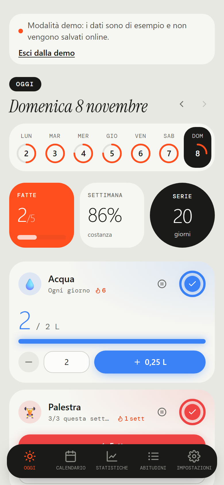
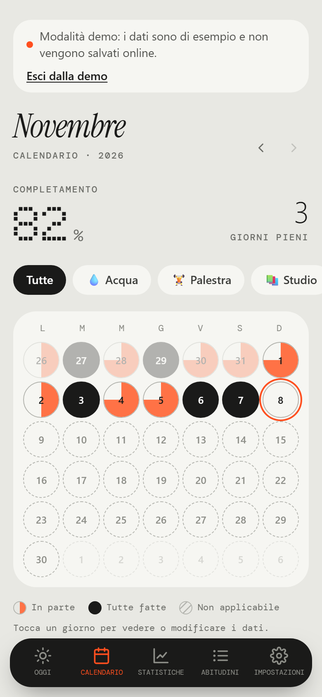
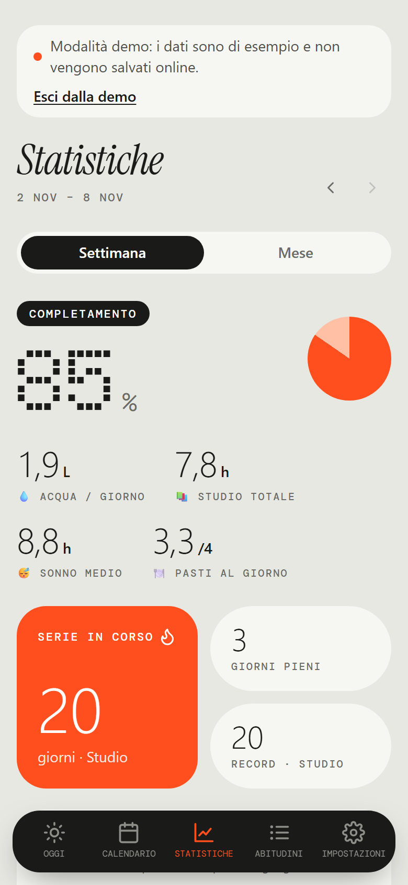
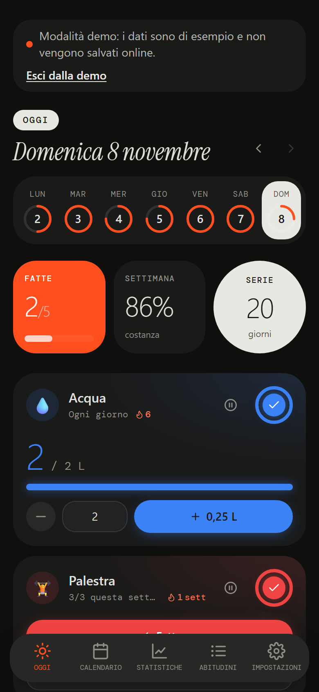
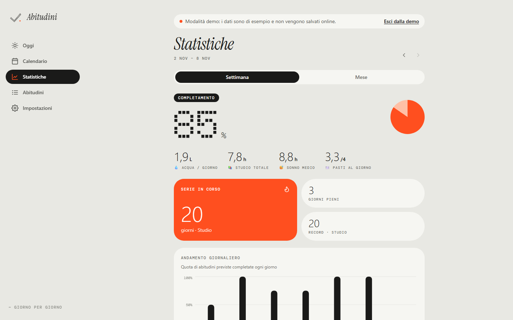

# Abitudini — Habit Tracker

App personale per tracciare abitudini, sonno e pasti. Pensata per il telefono, comoda anche su desktop. Si installa come un'app e funziona anche offline.

**Prova la demo, senza account:** https://habit-tracker-eta-three-88.vercel.app/?demo

<p>
  
  
  
  
</p>



**Stile "strumento di misura"**: grigio caldo, nero inchiostro e un solo accento arancio; etichette monospaziate, titoli in corsivo con grazie e numeri giganti a puntini come un display. Il logo è una spunta disegnata a penna.

## Funzionalità

- **Oggi** — le abitudini previste per la giornata con check-in rapido, navigazione ai giorni precedenti e riepilogo della costanza settimanale.
- **Cinque tipi di tracciamento**
  | Tipo | Cosa si registra |
  |---|---|
  | Fatto / non fatto | completamento + nota breve |
  | Quantità | numero con unità e obiettivo, pulsante di incremento rapido |
  | Durata | minuti + argomento (con suggerimenti dagli argomenti già usati) |
  | Sonno | ora a letto e sveglia, ore calcolate anche a cavallo della mezzanotte |
  | Pasti | colazione, pranzo, merenda, cena: fatto/saltato, cosa e porzione |
- **Frequenze** — ogni giorno, giorni specifici della settimana, oppure X volte a settimana.
- **Giorni non applicabili** — per una singola abitudine o per tutta la giornata (vacanza, malattia): non interrompono la serie e non contano nelle percentuali.
- **Streak** — serie attuale e record; in settimane per le abitudini "X volte a settimana".
- **Calendario** — vista mensile complessiva o per abitudine, con i giorni a cerchio che si riempiono come una torta e il riepilogo del mese; tocca un giorno per vedere e modificare i dati.
- **Statistiche** — completamento settimanale/mensile, media del sonno, media dell'acqua, ore di studio, serie in corso e record, grafici dell'andamento e una lancetta per ogni abitudine.
- **Account e sincronizzazione** — accesso via email senza password (link o codice), dati sincronizzati tra telefono e computer.
- **Installabile e offline** — si aggiunge alla schermata Home; senza connessione si apre lo stesso e le modifiche partono appena torna la rete.
- **Demo** — dati di esempio verosimili, senza account (`/?demo`).
- **Tema chiaro/scuro** — segue il sistema, con scelta manuale.
- **Backup** — export e import dei dati in JSON.

## Stack

React 19 · TypeScript · Vite · Tailwind CSS 4 · Recharts · Supabase (Auth + Postgres con Row Level Security) · Vercel · Vitest

Caratteri inclusi nel progetto (funzionano anche offline): DM Mono, Doto, Instrument Serif. Colori e caratteri sono definiti una volta sola in [`src/index.css`](src/index.css).

## Avvio

```bash
npm install
npm run dev
```

Senza configurazione l'app salva i dati solo nel browser. Per il login e la sincronizzazione serve un progetto Supabase:

1. Esegui [`supabase/migrations/20261103000000_init.sql`](supabase/migrations/20261103000000_init.sql) nello SQL Editor del progetto.
2. In **Authentication → URL Configuration** imposta il Site URL e aggiungi gli indirizzi dell'app (anche `http://localhost:5173/**`) tra i Redirect URLs.
3. Crea `.env.local`:
   ```bash
   VITE_SUPABASE_URL=https://<progetto>.supabase.co
   VITE_SUPABASE_PUBLISHABLE_KEY=sb_publishable_...
   ```

Altri comandi:

```bash
npm run build      # typecheck + build di produzione in dist/
npm run preview    # serve la build (con il service worker attivo)
npm test           # test della logica e dello storage
```

## Struttura

```
src/
├── types.ts            Modello dei dati (Habit, Entry, AppData…)
├── storage/            Unico punto di accesso ai dati
│   ├── types.ts        Interfaccia StorageAdapter
│   ├── localStorage.ts Salvataggio nel browser (senza account e demo)
│   ├── supabase.ts     Salvataggio su Supabase
│   ├── offline.ts      Copia locale + coda delle modifiche fatte offline
│   ├── backup.ts       Validazione/migrazione ed export JSON
│   ├── seed.ts         Abitudini iniziali
│   └── demo.ts         Dati di esempio per la demo
├── lib/                Logica pura, senza React (testata)
│   ├── dates.ts        Date locali YYYY-MM-DD, settimane da lunedì
│   ├── schedule.ts     Quando un'abitudine è prevista
│   ├── progress.ts     Avanzamento, completamento, stato del giorno
│   ├── streak.ts       Serie in giorni o settimane
│   ├── stats.ts        Percentuali e medie
│   └── sleep.ts        Calcolo delle ore di sonno
├── state/              Store React, login, tema, router via hash
├── components/         UI riutilizzabile, tracker per ogni tipo
└── pages/              Oggi, Calendario, Statistiche, Abitudini, Impostazioni, Accesso
public/
├── manifest.webmanifest  Nome, icone e colori dell'app installata
└── sw.js                 Service worker: l'app si apre anche offline
supabase/migrations/      Schema del database
```

### Dati

Tutto l'accesso ai dati passa da `src/storage/` tramite l'interfaccia `StorageAdapter`, asincrona e granulare (salva un'abitudine, una registrazione, un giorno non applicabile…). Il resto dell'app non sa dove finiscono i dati:

- **senza account / demo** → `localStorage`
- **con account** → Supabase, avvolto da `offline.ts`: ogni modifica aggiorna subito una copia locale e va in una coda salvata nel browser, che viene inviata appena il server risponde. Così l'app resta usabile senza rete e non perde nulla se la chiudi offline.

Nel database ogni riga ha lo `user_id` del proprietario e le policy di Row Level Security impediscono di leggere o modificare i dati degli altri.

Le date sono stringhe locali `YYYY-MM-DD`: si confrontano come testo e non risentono di fusi orari o cambi dell'ora legale.

### Regole di calcolo

- **Completato** — obiettivo raggiunto: quantità ≥ obiettivo, ore di sonno ≥ obiettivo, minuti ≥ obiettivo (o almeno un minuto se non c'è obiettivo), pasti fatti ≥ obiettivo (4 di default).
- **Il sonno** si registra sul giorno del risveglio.
- **Oggi** non ancora completato non interrompe la serie e non abbassa le percentuali: è "in corso". Lo stesso vale per la settimana in corso delle abitudini "X volte a settimana".
- **Abitudini settimanali** — se nella settimana ci sono giorni non applicabili, le volte richieste scendono al massimo ai giorni disponibili.
- Le statistiche partono dalla data di creazione dell'abitudine; inserire dati in un giorno precedente sposta l'inizio a quel giorno.

## Roadmap

- [x] **Fase 1** — app completa con dati locali, export/import JSON
- [x] **Fase 2** — login e sincronizzazione con Supabase, pubblicazione su Vercel
- [x] **Fase 3** — PWA installabile, uso offline, demo, screenshot
- [x] **Fase 4** — nuova grafica partendo da screenshot di riferimento (image-to-code) e nuovo logo
- [ ] **Promemoria** — notifiche push a un orario scelto (richiedono un invio programmato lato server)
